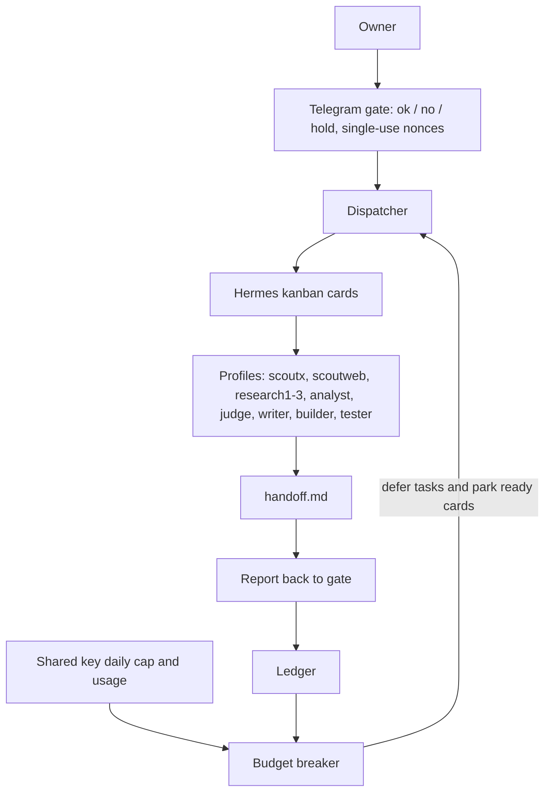
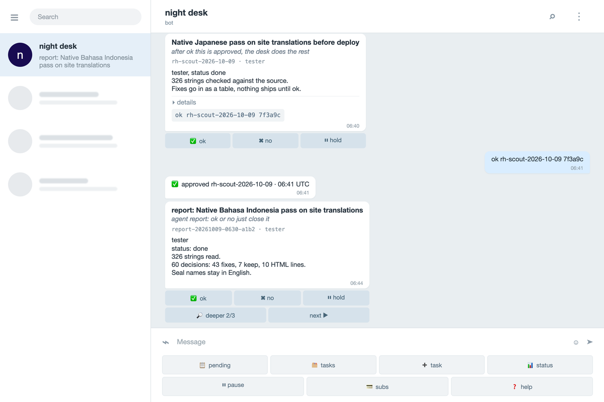

# Hermes team kit

A Telegram gate, task router, ledger and budget breaker for a team of Hermes agents.


[](https://github.com/qvotvm/hermes-team-kit/actions/workflows/tests.yml)

- Review proposals and agent reports in Telegram with **ok / no / hold** decisions protected by single-use nonces. The gate makes no model calls.
- Route owner messages into Hermes kanban cards for ten role profiles, then receive their handoff reports for review.
- Record completed work in a local ledger, report dollars spent per accepted task per profile, and defer dispatch near a shared key's daily cap.


## How it works



The owner reviews the returned report. **ok** marks a task accepted for accounting.
The breaker does not interrupt running cards; use a provider-side cap for a hard
spending limit. See [operation and accounting](docs/OPERATION.md) for the full
command list, cost semantics, guest access, locale support and fallback behavior.




## Quickstart

On Debian 12+ or Ubuntu 24.04+, as the non-root user that owns your Hermes install:

1. Obtain a trusted local checkout and run `sh install/install.sh`. It verifies
   SHA-256 hashes, creates `config.toml`, runtime directories and all ten profile
   templates, and preserves existing files on subsequent runs.
2. Edit `config.toml`: replace the placeholder Telegram IDs, provider endpoint
   and model. Set `hermes.command` to the **absolute** path of your Hermes CLI
   (systemd does not inherit your interactive PATH). Use a dedicated board name
   and ensure no other gateway or dispatcher runs that board.
3. Put `TELEGRAM_BOT_TOKEN` and your configured model environment variables into
   `service.env`, with `chmod 600 service.env`. For the sample capped layout,
   each group has its own key variable. A shared key belongs in one group,
   so its spending is counted once. Remove unused seat groups for a smaller team.
4. Run the installer again after editing configuration. It refreshes generated
   profile configs that you have not modified; manual profile edits are preserved.
   Profiles live under `${HERMES_HOME:-$HOME/.hermes}/profiles/`.
   Exported model credentials at install time seed each profile's `.env`;
   otherwise set those files yourself. Never put the bot token in a profile.
5. Start locally to verify configuration:

   ```sh
   set -a
   . ./service.env
   set +a
   export TEAM_CONFIG="$PWD/config.toml"
   python3 gate/gate.py
   ```

   In a second terminal with the same environment, run
   `python3 take-tasks/take-tasks.py` and `python3 install/dispatch.py` after
   sending the bot `/start`, then `task write code to parse a public dataset`.
   The task appears under `var/gate/tasks/`; a card ID appears under
   `var/out/tasks/`. The profile writes `handoff.md` with `## owner (en)` and
   `## details (en)`. The report returns to the gate for review.
6. The single documented root step installs and enables systemd services:

   ```sh
   sudo sh install/install-systemd.sh YOUR_USER /absolute/path/to/kit
   ```

   Keep the default `var/` layout when using the units. If you relocate runtime
   paths, adjust `ReadWritePaths` in the gate unit before starting it. Inspect
   `journalctl -u team-gate -u team-tasks` if a task stays queued.

## Requirements

Python 3.11+ and the standard library are sufficient for the kit. Use an existing
Hermes installation with profiles and the kanban `create`, `show`, `list`,
`reassign`, `schedule`, `unblock` and `dispatch` commands. Install Hermes separately
from a source you trust; this installer downloads nothing.

The documented systemd setup targets Debian 12+ or Ubuntu 24.04+. Run the kit
as the non-root account that owns Hermes. Live use needs a Telegram bot token,
your owner ID, and credentials for an OpenAI-compatible model provider.

## Configuration

Edit `config.toml` and keep credentials in `service.env` or the profile `.env`
files. The sample file documents paths, limits, seat groups and locale settings.

| Key option | Configuration |
| --- | --- |
| Any OpenAI-compatible key | Set `provider.base_url`, `model`, and `api_key_env`; remove the seat sections if uncapped. |
| A key with a daily dollar cap | Put every profile sharing that key in one seat group and set `daily_cap_usd`. |
| A capped seat key | The same seat-group configuration; no special provider required. |
| A second compatible provider | Fill the optional `fallback` section; profile configs use Hermes' fallback model support. |

## Stopping the desk and hourly spend

Any installed desk profile can stop new work with a reason:

```sh
python3 breaker.py stop --profile builder --reason "unexpected tool behavior"
```

The owner can send `/stop <reason>` (or `stop <reason>`) to the Telegram gate.
Only an owner in a private owner chat can send `/reset <reason>` (or
`reset <reason>`). Both actions append their actor, reason and timestamp to
`paths.ledger`; a manual stop persists across restarts and daily resets.
`/resume` only clears the older pause flag, never the manual breaker stop.
Fresh profile templates include the stop command with absolute paths filled by
the installer. Existing customized profiles are preserved; add that command
to their instructions yourself when updating an existing desk.
Ready cards are parked; running cards may finish. Reset releases only cards
parked by the breaker and still respects budget caps. The default same-user
trust model applies: profile names identify actors, not OS-isolated identities.

Set `limits.hourly_usd` to a positive dollar amount to cap the whole desk's
completion spend over a rolling 60-minute window. The default `0` disables it.
The window uses ledger timestamps, including all groups and providers, even
when a daily usage endpoint is configured. At or above the limit the breaker
trips with reason `hourly cap`; unknown completion costs also block while in
the window. It resets automatically on the next dispatch check when the
window drops below the cap. A simultaneous manual stop still needs an owner
reset. Daily group limits continue to apply separately.

These limits stop new tasks, not calls inside running tasks. Completion costs
arrive after a run; use provider-side limits for a hard spending ceiling.
Use the kit dispatcher exclusively on its dedicated board. The final breaker
check and launch share a lock with stop/reset, so a stop acknowledged before
that check prevents a new launch.

## Security

The services run as your non-root account. The default single-user mode trusts
that account and its agents with the bot credentials and decision state; this
is a convenience deployment, not OS isolation. Read the
[threat model](docs/THREAT-MODEL.md) before allowing untrusted agents or guests.
No model, publication, release or remote action happens during installation.
See [SECURITY.md](SECURITY.md) for private vulnerability reporting.

## Verification

```sh
python3 tests/run.py
python3 tests/check_source.py
python3 tests/smoke/local.py
```

The smoke test copies a fresh tree into a temporary directory, installs twice,
sends an English owner update through the real gate, creates a card through
the real dispatcher and an isolated fake Hermes CLI, files its English report,
accepts it through the gate, and checks the ledger and tampered-hash rejection. It uses no credentials or
network. Run `sh tests/smoke/vm.sh` inside a fresh VM as its non-root user; set
`CHECK_SERVICES=1` after completing the real service setup to check the units.
Live Telegram/model execution and VM service setup require your own environment.
CI runs the suites and local smoke test on each push and pull request.

## Layout

| Path | Contents |
| --- | --- |
| `gate/` | Single-file Telegram gate |
| `take-tasks/` | Task dispatcher |
| `profiles/` | Ten role templates |
| `install/` | Installer, integrity hashes and systemd units |
| `docs/` | Operation, threat model and image placeholders |
| `tests/` | Unit checks and local/VM smoke tests |
| `dash/` | Optional dashboard access notes |
| `ledger.py`, `breaker.py`, `kit_config.py` | Accounting, budget control and shared configuration |

Nothing is published by this repository. Contributions follow
[CONTRIBUTING.md](CONTRIBUTING.md). Licensed under [MIT](LICENSE).
